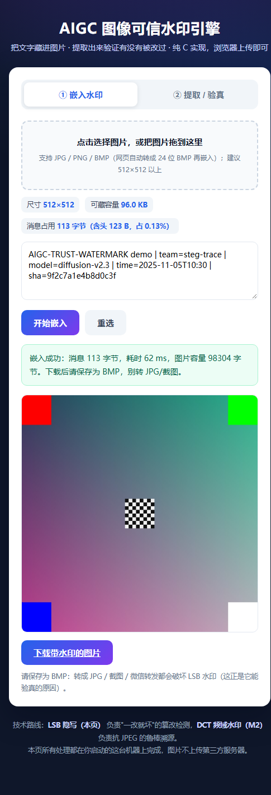
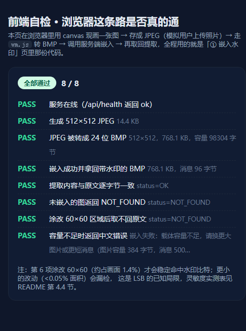

# AIGC 图像可信水印引擎 · 里程碑 M1 交付包

[](https://github.com/buu-yun/aigc-image-watermark/releases/tag/v0.1.0-m1)
[](LICENSE)
[](#)
[](#)
[](#35-网页版把引擎变成别人能打开的网址)

### 👉 在线试用（免安装、免注册、图片不上传）：**https://buu-yun.github.io/aigc-image-watermark/**

> 那个页面里跑的不是 JS 复刻，而是把 `bmp.c` / `lsb.c` 用 clang 编成的 **7 KB WebAssembly** —— 同一份 C 源码，跑在你浏览器里。

> 目标：**能藏能取** —— 手写 24 位 BMP 读写 + LSB 隐写，跑通最小闭环。
> 约束：纯 C99 + 标准库，Windows + gcc，无第三方依赖。

---

## 0. 一句话结论

M1 已完成：324 字节中文 UTF-8 消息 **往返逐字节一致**，嵌入后最大像素差 = 1（肉眼不可见），
`wm selftest` **17 项断言全部 PASS**；并且实测摸清了 LSB 的篡改灵敏度边界
（补丁 ≥ 20×20 稳定检出，≤ 10×10 会漏检），这组数据直接决定 M3 的冗余/分块设计。

---

## 0.5 仓库结构

```
aigc-image-watermark/
├── bmp.h / bmp.c          24 位 BMP 读写（手写；内存版 + 文件包装两层）
├── lsb.h / lsb.c          LSB 隐写核心：铺开映射、比特读写、10 字节头
├── main.c                 CLI：embed / extract / info / diff / tamper / selftest / bench
├── make_test_image.c      生成测试载体（无外部素材、无版权问题）
├── wm_server.c            微型 HTTP 服务（WinSock，零第三方库）
├── web/
│   ├── index.html         浏览器界面：① 嵌入水印  ② 提取 / 验真
│   ├── wm.js              JPG/PNG → 24 位 BMP（规则与 bmp.c 严格一致）
│   └── selftest.html      前端自检页（8 项断言，浏览器里跑）
├── build.bat              一键编译 3 个产物
├── serve.bat              一键启动网页服务（默认 8080）
├── demo.bat               一键端到端演示
├── run_m1_acceptance.ps1  CLI 验收脚本（14 项断言）
├── README.md
└── LICENSE                MIT
```

三种用法，按需选一种：

```bat
demo.bat            :: 命令行跑一遍完整流程，看 PASS
serve.bat           :: 起网页服务，别人用浏览器访问
build.bat           :: 只要编译产物
```

---

## 1. 文件清单

| 文件 | 作用 | 行数量级 |
|---|---|---|
| `bmp.h` / `bmp.c` | 24 位 BMP 读写（手写，答辩可逐行讲） | ~330 |
| `lsb.h` / `lsb.c` | LSB 隐写核心：铺开映射、比特读写、10 字节头 | ~300 |
| `main.c` | CLI：`embed` / `extract` / `info` / `diff` / `selftest` | ~520 |
| `make_test_image.c` | 生成测试载体（渐变+纯色块+棋盘），免去找图/版权问题 | ~80 |
| `build.bat` | 一键编译（含网页服务） | — |
| `demo.bat` | 一键端到端演示：编译→自检→嵌入→提取→比对→篡改→再提取 | — |
| `serve.bat` | 一键启动网页服务（默认 8080 端口） | — |
| `wm_server.c` | 微型 HTTP/1.1 服务（WinSock，零第三方库），把引擎变成网址 | ~430 |
| `web/index.html` | 浏览器界面：上传→嵌入→下载 / 提取验真 | ~330 |
| `web/wm.js` | 前端公共逻辑：JPG/PNG→24 位 BMP、请求封装 | ~130 |
| `web/selftest.html` | 前端自检页（浏览器里跑 8 项断言） | ~150 |
| `wasm/wm_glue.c` | 把引擎包成 wasm 接口：`wm_embed` / `wm_extract` / `wm_capacity` | ~120 |
| `wasm/build_wasm.bat` | 一条命令产出 `wm.wasm`（zig cc） | — |
| `wasm/pack_static.ps1` | 把 wasm 以 base64 内嵌，产出单文件站点 | — |
| `wasm/test_wasm.mjs` | node 端到端自检（7 项） | ~60 |
| `docs/index.html` | **可托管的单文件整站**（GitHub Pages 就是它） | 29.8 KB |
| `run_m1_acceptance.ps1` | 一键验收（编译→嵌入→提取→比对→篡改测试） | ~80 |
| `sample_msg_utf8.txt` | 中文 UTF-8 测试消息（324 字节） | — |
| `test_image.bmp` | 512×512 测试载体 | 786 KB |
| `stego.bmp` / `extracted.txt` | 演示产物：含水印图 / 取回的明文 | — |

---

## 2. 编译

```bat
build.bat
```

或手写命令（与赛题给的命令形式一致）：

```bat
gcc -std=c99 -O2 -Wall -Wextra -o wm.exe bmp.c lsb.c main.c
gcc -std=c99 -O2 -Wall -Wextra -o make_test_image.exe make_test_image.c bmp.c
```

> M1 全部是整数运算，**不需要 `-lm`**；赛题模板里有 `-lm` 也无害，M2 上 DCT 的 `cosf` 才真正需要。

---

## 3. 五分钟演示（照抄即可）

**最省事**：双击 `demo.bat`（或在 `E:\dswork` 里执行 `demo.bat`），它会把下面 7 步全跑一遍，
最后打印 `DEMO PASSED`，退出码 0。

想一步步看，逐条执行：

```bat
make_test_image.exe test_image.bmp 512 512
wm.exe selftest
wm.exe bench
wm.exe embed -i test_image.bmp -o stego.bmp -f sample_msg_utf8.txt
wm.exe extract -i stego.bmp -o extracted.txt
wm.exe diff  -i test_image.bmp -j stego.bmp
wm.exe info  -i stego.bmp
```

真实运行输出（本机 gcc 16.2.0 / MSYS2）：

```
=== M1 自检：LSB 隐写闭环 ===
[用例1] 不同消息长度的往返一致性
  [PASS]    1 字节消息往返一致
  [PASS]    5 字节消息往返一致
  [PASS]   17 字节消息往返一致
  [PASS]   64 字节消息往返一致
  [PASS]  255 字节消息往返一致
  [PASS] 1000 字节消息往返一致
[用例2] 容量边界（刚好塞满 / 多 1 字节）
  [PASS] 容量上界 24566 字节可完整塞入并取回
  [PASS] 超出容量 1 字节时报 LSB_ERR_CAPACITY
[用例3] 无水印图像识别
  [PASS] 空白图 lsb_peek 返回 NOT_FOUND
  [PASS] 空白图 lsb_extract 返回 NOT_FOUND
[用例4] 视觉不可见性
  [PASS] 嵌入后最大通道差 <= 1（肉眼不可见）
  [PASS] 确实改动了像素（不是空操作）
         统计: 最大差 1，改动 106 / 786432 通道
[用例5] 重复嵌入（后写覆盖先写）
  [PASS] 二次嵌入后取回的是最后一次的内容
[用例6] 翻转 1 个水印比特
  [PASS] 翻转 1 bit 后取回内容与原文不同（M1 无法自证清白 → M2 上 CRC）
[用例7] 涂白画面中部一块区域
         涂改覆盖 10800 / 786432 通道（1.37%）
  [PASS] 局部涂改后无法原样取回（铺开映射生效）
=== 结果: 全部通过（失败 0 项）===
```

```
[embed] 载体 test_image.bmp  512x512
[lsb] 载体 512x512，可用容量 98304 字节
[lsb] 本次占用 334 字节（头 10 + 消息 324），使用率 0.34%
[lsb] 步长 7919（与通道总数 786432 互质），水印均匀铺满全图
[embed] 已生成: stego.bmp（BMP 无损保存，LSB 不会被重新编码破坏）

[lsb] 命中水印：版本 1，方法 0(LSB)，消息长度 324 字节
AIGC 可信水印测试消息 v1.0
作者: 张同学 | 团队: 隐写溯源小队
...
[extract] 已写出明文: extracted.txt（324 字节）

最大通道差 : 1  (0=完全相同, 1=只有最低位变了)
改动通道数 : 1352 / 786432 (0.1719%)
结论       : 仅最低位变化，视觉不可见（符合 LSB 预期）

水印      : 检测到 LSB 水印，消息 324 字节，占容量 0.3398%
```

> 中文若在 `cmd` 里显示成乱码：先执行 `chcp 65001`。
> 关键校验不看控制台，而看 `extracted.txt` 与 `sample_msg_utf8.txt` **字节级比对**（已实测相同）。

---

## 3.5 网页版：把引擎变成"别人能打开的网址"

### 在线版：C 编译成 WebAssembly（推荐给别人看）

上面那个 `wm_server.exe` 需要你的电脑开着。如果只想给别人一个**永久链接**、谁都能点开，用这个：

**https://buu-yun.github.io/aigc-image-watermark/**

- 引擎 = `bmp.c` + `lsb.c` + `wasm/wm_glue.c` 用 `clang`（zig cc）编成的 **7 KB wasm**；
- 页面 = **单个 29.8 KB 的 HTML**，wasm 以 base64 内嵌，`file://` 双击也能跑；
- **无后端、无网络请求**，图片根本不出浏览器，所以能白嫖 GitHub Pages 这类纯静态托管。

重建方法：

```bat
wasm\build_wasm.bat                              :: C -> wm.wasm
powershell -File wasm\pack_static.ps1            :: 内嵌 base64 -> docs\index.html
```

体积优化的关键：编译时用 `-Dprintf=wm_noop_printf` 把日志换成空函数，wasm 从 **1 MB 掉到 7 KB**
（否则 wasi-libc 的整套格式化输出会被拖进来）。这个取舍在答辩里可以讲一句：**"嵌入式环境下，printf 是奢侈品"**。

验证链（三层互证）：

| 验证 | 结果 |
|---|---|
| `node wasm/test_wasm.mjs` | 7/7（容量/嵌入/提取/NOT_FOUND/错误码） |
| 本地 `wm.exe` 提取 wasm 生成的图 | 成功 → **两套实现字节级互通** |
| Edge headless 打开公网地址 | 页面自检 7/7，选图→嵌入 21~159 ms |

### 启动本地服务版

```bat
serve.bat
```

或：

```bat
gcc -std=c99 -O2 -Wall -Wextra -o wm_server.exe wm_server.c bmp.c lsb.c -lws2_32
wm_server.exe 8080
```

启动后控制台会打出两个地址：

```
  本机访问:  http://localhost:8080
        http://10.40.213.192:8080      (同一 WiFi 的队友用这个)
```

- 队友**同一 WiFi** 下直接输这个 IP 就能用（首次启动 Windows 会弹防火墙提示，选"允许专用网络"）。
- 手机连同一 WiFi 也能打开，直接拍照上传。
- 服务是**单线程顺序处理**，一次一个请求，答辩演示完全够用；并发要上线程池，留到 M4。

### 页面能干什么

| 页面 | 功能 |
|---|---|
| `/` | ① 拖入图片 → 填写文字 → 嵌入 → 浏览器内预览 + 下载 `xxx_watermarked.bmp`；② 拖入图片 → 提取 → 显示明文与"水印完整/未检测到/头部损坏"三态判断 |
| `/selftest.html` | 浏览器端自检，8 条断言全绿才说明这条路真通 |
| `/api/health` | 返回 `ok`，给运维/探活用 |

### 关键设计：为什么前端要把 JPG 转成 BMP

M1 的引擎只吃 24 位 BMP（M2 才用 stb 收编 JPG/PNG），但用户上传的都是 JPG。
解法是**在浏览器里用 canvas 光栅化，再手写 54 字节 BMP 头打包**（`web/wm.js`），C 端仍然只处理 BMP：

- 不提前动 M2 的 stb，里程碑不跳步；
- 上传体积可控（JPG 进来，BMP 出去给服务端）；
- 这段打包逻辑和 `bmp.c` 的三条规则必须完全一致：BGR 顺序、4 字节行对齐、自下而上 —— 讲清楚就是加分项。

### 接口（刻意不用 multipart）

```
POST /api/embed    body = [4B 小端消息长度][UTF-8 消息][24 位 BMP]
                   → 200 + 带水印 BMP；头部 X-WM-MsgLen / X-WM-Capacity / X-WM-Width / X-WM-Height
POST /api/extract  body = [24 位 BMP]
                   → 200 + text/plain 明文；头部 X-WM-Status: OK | NOT_FOUND | CORRUPT
```

不解析 multipart，是因为边界字符串扫描是最容易出错的代码；用"长度前缀 + 原始字节"这套自定帧，
解析代码 4 行就写完，错误全部走 HTTP 状态码 + 中文提示。

### 安全与限制（自己写服务必须交代的）

| 项 | 做法 |
|---|---|
| 目录穿越 | 只允许 `web/` 下 `.html/.js/.css/.png/.jpg/.ico`，拒绝 `..`、反斜杠、盘符 |
| 请求体上限 | 64 MB，超了返回 413 |
| 慢连接 | 每个连接设 15 秒读写超时 |
| 内存 | 图片全在内存处理，不写临时文件；失败路径全部 free |
| 公网 | **默认只监听 0.0.0.0 的本机网络**。要真公网需云服务器 + 安全组放行端口，别直接拿宿舍电脑裸奔；M4 会加口令/限流 |

### 实测证据

浏览器端自检（Edge headless + DevTools 协议实跑，非模拟）：

```
RESULT: 8/8
PASS 服务在线（/api/health 返回 ok）
PASS 生成 512×512 JPEG 14.4 KB
PASS JPEG 被转成 24 位 BMP 512×512，768.1 KB，容量 98304 字节
PASS 嵌入成功并拿回带水印的 BMP 768.1 KB，消息 96 字节
PASS 提取内容与原文逐字节一致 status=OK
PASS 未嵌入的图返回 NOT_FOUND status=NOT_FOUND
PASS 涂改 60×60 区域后取不回原文 status=NOT_FOUND
PASS 容量不足时返回中文错误
```




---

---

## 3.6 M2：频域水印（抗 JPEG）+ CRC 三态判定

### 一句话

M1 的水印"发个微信就没了"；M2 把它藏进**频域中频系数**，压成 JPEG 也能原样取回，并且能给出**真 / 可疑 / 假**的结论。

### 三个关键设计

| 设计 | 做法 | 为什么 |
|---|---|---|
| **关系编码** | 每块取中频系数对 A=(v3,u2)、B=(v2,u3)，规定 `bit=1 → |A|-|B| ≥ T`、`bit=0 → |B|-|A| ≥ T`，只抬高较小的那个 | JPEG 会把两个系数**同时**缩放，但"谁大谁小"基本不变 —— 抗压缩的根就在这里 |
| **冗余 + 软判决** | 头部 5 份、正文 3 份，落在间隔 80 / N 的块上；提取把 3 份的差值**求和再取符号** | 少数块被压坏/涂掉，求和后方向不变；软判决比"投票"更能抗噪 |
| **双通道判定** | DCT 带 CRC16（扛得住压缩）；LSB 写 16 份 4 字节哨兵（对像素极敏感） | 一个负责"内容对不对"，一个负责"像素动没动"，两者组合出三态 |

### 实测：抗 JPEG（1024×768，242 字节中文消息）

| JPEG 质量 | 文件大小 | 能否逐字节取回 | 判定 |
|---|---|---|---|
| q95 | 50.7 KB | ✅ | 可疑（像素被重编码） |
| q85 | 28.0 KB | ✅ | 可疑 |
| q75 | 21.4 KB | ✅ | 可疑 |
| q50 | 19.1 KB | ✅ | 可疑 |
| q40 | 18.6 KB | ✅ | 可疑 |
| q30 | 18.4 KB | ✅ | 可疑 |
| **q20** | 13.5 KB | ❌ | 无水印（失守） |

> q95→q30 全部**逐字节一致**；q20 以下失效。这个数字写进报告即可，不必强行压到 q10。

### 实测：三态判定

| 对图片做了什么 | DCT 水印 | LSB 哨兵 | 结论 | 退出码 |
|---|---|---|---|---|
| 原样保存 BMP | 成功 | 16/16 | **【真】** | 0 |
| 转 JPEG q75 | 成功（CRC 通过） | 0/16 | **【可疑】** 内容可信、像素被动过 | 2 |
| 涂改一小块（1.8%） | 成功（CRC 通过） | 6/16 | **【可疑】** | 2 |
| 大面积涂改（破坏头部） | CRC 失败 | 1/16 | **【假】** | 3 |
| 没嵌过水印的图 | 未找到 | — | **【无水印】** | 4 |

### 怎么跑

```bat
demo_m2.bat                                  :: 一条命令演完：嵌入→提取→JPEG→验真→篡改
powershell -File run_m2_acceptance.ps1       :: 完整回归（含 q95→q10 全表）
```

### 容量（每块只藏 1 bit，把容量全换成鲁棒性）

| 分辨率 | 8×8 块数 | 可藏正文 |
|---|---|---|
| 512×512 | 4096 | 154 字节 |
| 1024×768 | 12288 | 495 字节 |
| 1920×1080 | 32640 | 1343 字节 |

### 已知局限（要写进报告）

1. **JPEG q20 以下失效**：量化步长已接近阈值 T=24，中频系数被抹平。
2. **裁剪失效**：块网格一移位，坐标映射就全乱（M3 用分块冗余 + 重同步解决）。
3. **CRC 不抗主动伪造**：算法公开，攻击者可重算 CRC；真正的防伪需要密钥（M4 的 HMAC）。
4. **水印占块越多，同等涂改越容易被判【假】** —— 这是"鲁棒性"的另一面，不是 bug。
---

## 3.7 M3：分块冗余抗裁剪 + 篡改定位 + 性能数据

### 一句话

M2 能扛压缩，但**裁一刀就全乱**（块序号一变，比特全错位）。M3 把图切成 256×256 的瓦片，
**每个瓦片存一份完整水印**，裁掉四分之三也还能读出整条消息。

### 三个新能力

| 能力 | 做法 | 代价 |
|---|---|---|
| **抗裁剪** | 瓦片内用局部坐标做**平衡映射** `(i*397) % 512`（397 与 512 互质 → 每个槽位恰好 2 个块），每瓦片一份完整副本；解码端再试 64 种像素偏移做**重同步** | 单条消息上限 **54 字节** |
| **自适应阈值** | 按块内系数能量定余量：纹理块 T 大、平坦块 T 小（T∈[20,40]） | 无 |
| **篡改定位** | 每块的判决符号与最终比特比对，按 4×4 网格统计"反水率"，>15% 标红并输出热力图 | 无额外容量 |

> 为什么不能用哈希分配：1024 个块哈希到 512 个槽位，生日悖论会让某些槽位**一个块都分不到**，
> 那些比特解码时只能猜 0 —— 实测整帧就此作废。改成互质乘法双射后一次通过。

### 实测：抗裁剪（1024×768，49 字节消息，12 份完整副本）

| 裁剪方式 | 剩余尺寸 | 结果 |
|---|---|---|
| 右裁 25% | 768×768 | ✅ 逐字节一致 |
| 右裁 50% | 512×768 | ✅ 逐字节一致 |
| **右裁 75%** | 256×768 | ✅ 逐字节一致 |
| 下裁 33% | 1024×512 | ✅ 逐字节一致 |
| 下裁 66% | 1024×256 | ✅ 逐字节一致 |
| 右裁 100px（非 8 的倍数） | 924×768 | ✅ 一致（靠重同步） |
| 左裁 100px | 924×768 | ❌ 读不出（已知局限，见下） |

### 实测：Tile 模式抗 JPEG

| 质量 | q90 | q75 | q60 | q30 | q20 |
|---|---|---|---|---|---|
| 结果 | ✅ | ✅ | ✅ | ✅ | ❌ |

### 实测：篡改定位

涂改一块 200×200（x=600,y=300）后：

```
篡改定位 : 最高反水格 第 3 行第 3 列，22%
           该格有超过 15% 的块与多数派相反 → 很可能被局部编辑过
```

`wm heatmap` 会把反水率超阈值的格子用红框画出来，直接给人看。

### 性能与画质（`wm bench`，本机 -O2）

| 分辨率 | LSB | DCT | Tile |
|---|---|---|---|
| 512×512 | 0.00 ms / 77.6 dB | 3.30 ms / 40.3 dB | 4.60 ms / 39.5 dB |
| 1024×768 | 0.10 ms / 82.7 dB | 4.40 ms / 45.1 dB | 14.80 ms / 39.5 dB |
| 1920×1080 | 0.60 ms / 87.0 dB | 5.80 ms / 49.3 dB | 40.00 ms / 39.5 dB |

### 三种模式怎么选

| 模式 | 容量 | 抗压缩 | 抗裁剪 | 用途 |
|---|---|---|---|---|
| `-m lsb` | 98 KB | ❌ | ❌ | 篡改哨兵（最灵敏） |
| `-m dct` | 495 B | ✅ q30 | ❌ | 大段溯源信息 |
| `-m tile` | **54 B** | ✅ q30 | ✅ 裁 75% | 短水印 + 要过剪切/二次编辑的场景 |

### 新增命令

```bat
wm.exe embed   -i 原图.bmp -o 带水印.bmp -f 消息.txt -m tile
wm.exe verify  -i 图.bmp                 :: 三态 + 篡改定位
wm.exe heatmap -i 图.bmp -o 热力图.bmp    :: 标红被改的格子
powershell -File run_m3_acceptance.ps1   :: 18 项 M3 验收
```

### 已知局限（更新）

1. **只能从右/下方向裁剪**：从左边/上边裁会让瓦片原点整体移位，块坐标全变（需要"同步模板"才能解决，留到 M4 或列为局限）。
2. JPEG q30 以下失效。
3. 单条消息上限 54 字节——抗裁剪的代价。
4. CRC 不抗主动伪造（M4 加密钥/HMAC）。
## 4. 设计原理（答辩就讲这五段）

### 4.1 为什么 LSB 是"辅助"而不是"主力"

| | LSB（空域） | DCT（频域，M2 起） |
|---|---|---|
| 容量 | 极高（每像素 3 bit） | 低（几十~几百字节） |
| 抗压缩 | 无（JPEG 一次就归零） | 强 |
| 抗裁剪 | 无冗余时全灭，铺开后"部分损坏" | 分块冗余可扛 |
| 视觉 | 改 ±1，不可见 | 改中频系数，不可见 |

本项目的定位分工：**DCT 负责"溯源"（藏得住、扛压缩），LSB 负责"验真"（一改就坏，天然篡改哨兵）**。
两者叠加，一个稳健、一个灵敏，正好互补——这也是 M2 的设计主线。

### 4.2 BMP 格式的四个坑（手写的价值就在这里）

1. **像素顺序是 B,G,R**，不是 RGB。写反了画面"蓝红互换"，但水印照样能取出来，很难发现。
2. **每行要 4 字节对齐**：512 宽 → 1536 字节已经对齐；513 宽 → 1539 → 补到 1540，多出 1 字节 padding。
   `channel_at()` 只走 `width*3` 个有效字节，**绝不碰 padding**，否则跨图迁移就错位。
3. **默认自下而上存储**（height > 0），第一行是图像**最底行**；height < 0 才是自上而下。
   本实现两种都能正确读出（已实测：把 stego.bmp 改成负高度 + 行序反转，提取内容仍一致）。
4. **全部整数小端序**，手写 `rd16/rd32/wr16/wr32`，不依赖任何平台头文件。

### 4.3 载荷格式（10 字节头）

| 偏移 | 长度 | 字段 | 说明 |
|---|---|---|---|
| 0 | 4 | `'A''I''G''C'` | 魔数：判断"这张图有没有我们的水印"，误判率 2⁻³² |
| 4 | 1 | `version = 1` | 格式版本，改结构时不误读 |
| 5 | 1 | `method = 0` | 0=LSB，1=DCT（M2 预留） |
| 6 | 4 | `len`（小端） | 消息字节数，32 位够用 |
| 10 | len | payload | 原始字节，**不转码**（UTF-8 进、UTF-8 出） |

提取端两道防御：魔数不符 → `NOT_FOUND`；`len` 超过载体可容纳范围 → `CORRUPT`（防伪造/损坏）。

### 4.4 铺开映射（M1 实战中修掉的真实缺陷）

**第一版顺序写入，实测翻车**：324 字节消息只占前 2672 个通道 ≈ 图像顶部 2 行像素，
在画面中部涂白 200×150（11.4% 面积）后，水印**一个字都没坏**——"一改就坏"成了摆设。

修复：第 k 个比特写到通道号 `(k * step) % total`，`step` 取与 `total` 互质的常数
（从质数 7919 起，不互质就 +1；同图两端算出同一个值，提取端必然复现）。
好处：

- 水印**均匀铺满全图**，任何局部改动都会命中约 `改动面积占比 × 水印比特数` 个比特；
- 步长与总数互质 ⇒ `k ∈ [0,total)` 恰好遍历所有通道，**不重复覆盖、不留空白区**；
- 只改一个函数就能换成"分块/密钥置乱"，为 M3/M4 的密钥化铺路。

实测灵敏度（324 字节水印，512×512 图，涂白方形补丁）：

| 补丁 | 改动通道占比 | 是否检出 |
|---|---|---|
| 3×3 | 0.003% | 漏检 |
| 5×5 | 0.010% | 漏检 |
| 10×10 | 0.038% | 漏检 |
| **20×20** | **0.153%** | **检出** |
| 40×40 | 0.610% | 检出 |
| 60×60 | 1.373% | 检出 |

结论写进报告：**LSB 的灵敏度 ≈ 改动面积 × 水印密度**，这是"已知局限"，M3 用冗余 + 分块定位来改善。

### 4.5 为什么是 ±1

`p = (p & 0xFE) | bit`：只改最低位，像素值最多变 1，视觉上不可能看出来；
而 `stb`/查看器/JPEG 的 DCT 量化会把这种微差直接抹平——**脆弱性正是它的功能**。

---

## 5. 验收标准（自查清单）

| 编号 | 验收项 | 判据 | 实测 |
|---|---|---|---|
| A1 | 编译零警告 | `-Wall -Wextra` 无输出 | ✅ |
| A2 | 多种长度往返 | 1/5/17/64/255/1000 字节逐字节一致 | ✅ |
| A3 | 容量上界 | 24566 字节可塞可回，超 1 字节报错 | ✅ |
| A4 | 无水印图 | 返回 `NOT_FOUND`，不误报 | ✅ |
| A5 | 视觉不可见 | 最大通道差 ≤ 1 | ✅ 最大差 1 |
| A6 | 中文往返 | 324 字节 UTF-8 逐字节一致 | ✅ |
| A7 | 篡改检出 | 60×60 涂白后取不回原文 | ✅ `NOT_FOUND` |
| A8 | 格式兼容 | 负高度（自上而下）BMP 也能读 | ✅ |
| A9 | 错误处理 | 非 BMP / 容量不足 / 空消息 均给明确提示 | ✅ |
| A10 | 一键回归 | `run_m1_acceptance.ps1` 全 PASS | ✅ 14/14 |

---

## 6. 容量与性能

| 分辨率 | LSB 容量 | 324 字节消息占用 |
|---|---|---|
| 512×512 | 98 304 字节 | 0.34% |
| 1024×768 | 294 912 字节 | 0.11% |
| 1920×1080 | 777 600 字节 | 0.04% |

`wm bench`（进程内计时，200 次取平均，-O2）：

```
=== 性能基准：512x512，消息 324 字节，各 200 次 ===
embed   : 0.0200 ms/次  → 约 50000 次/秒
extract : 0.0150 ms/次  → 约 66666 次/秒
```

结论（也是答辩可以讲的一点）：**LSB 的耗时与水印比特数成正比、与图片大小几乎无关**，
因为铺开映射只访问水印用到的 2672 个通道，不做全图扫描。
把 512×512 换成 1920×1080，同样的消息耗时基本不变。

---

## 7. 已知局限（M1，写进报告）

1. 只吃 **24 位未压缩 BMP**；PNG/JPG 到 M2 用 `stb_image` / `stb_image_write`。
2. **没有完整性校验**：故意改坏 1 bit 仍可能"成功"取出错误内容（M2 上 CRC16 定位、RS 纠错）。
3. **没有冗余**：裁剪掉的水印比特无法恢复；旋转/缩放直接全灭（团队已确认列为已知局限）。
4. 灵敏度与改动面积成正比（见 4.4 表），小额修改可能漏检。
5. `channel_at()` 每次做一次整除/取模，大图性能一般；M3 用指针游标优化并给数据。
6. 未做密钥化：任何人知道格式都能提取（M4 引入口令派生置乱/位置表）。

---

## 8. 常见问题排查

| 现象 | 原因 | 处理 |
|---|---|---|
| `[err] 嵌入失败: 载体容量不足` | 图太小或消息太长 | 提示里已给出容量与所需字节数，换大图或缩短消息 |
| `[bmp] 仅支持 24 位、无压缩(BI_RGB) BMP` | 图是 8/32 位或 RLE 压缩 | 用 `make_test_image.exe` 生成，或在画图里"另存为 24 位 BMP" |
| `缺少 'BM' 魔数` | 文件其实是 PNG/JPG，只改了扩展名 | 扩展名不作数，M1 只认 BMP 内容 |
| 提取出乱码 | 图片被重新保存/截图/微信传输（重编码） | LSB 已死，属预期；M2 的 DCT 才抗这个 |
| 中文显示乱码但文件正确 | 控制台代码页 | `chcp 65001`，或直接比对 `extracted.txt` 字节 |
| `-t "中文"` 取回不一致 | MinGW 的 `argv` 走 ANSI 代码页，中文被转成 GBK | **改用 `-f msg.txt`**（本工程推荐路径） |
| 输出图用某查看器看着偏色 | 查看器对 BMP 缓存/缩放 | 换 Windows 照片或 IrfanView 复核 |
| `gcc` 不是内部或外部命令 | 未装 MinGW/MSYS2 | 装 MSYS2 或 winlibs，把 `bin` 加进 PATH |

---

## 9. 路线图

- **M1（本次）**：LSB 闭环 ✅
- **M2**：CRC16 + 分块 DCT 中频嵌入，`wm verify` 给出"真/假"，LSB 作为篡改哨兵
- **M3**：抗 JPEG(q50~q90)/裁剪（分块冗余）、RS 纠错、性能与容量数据表
- **M4**：封装 `wm_embed()` / `wm_extract()` 库 + `libwm.h`，导出 DLL/静态库，交付 demo

---

## 10. 参考开源声明

- **nothings/stb** —— 仅 M2 起用于 PNG/JPG 编解码（`stb_image.h` / `stb_image_write.h`），不涉及水印算法。
- **RoliSoft/Steganography、Mal-Suen/DCT_Watermark_Tool** —— 仅参考其 LSB/DCT 实现思路与接口分层。

本工程 BMP 读写、比特映射、头部格式、CRC/DCT 全部自行实现，未整段复制上述项目的核心水印代码。
